# Explorador de Pokémon · Actividad 4: Miniaplicación web con API REST

Laboratorio de Programación Web · FIME, Universidad Autónoma de Nuevo León
Semestre Agosto - Diciembre 2026 · Brigada 406 · Plan 440
Catedrática: Laura Patricia Del Bosque Vega

| Matrícula | Nombre | Carrera |
|-----------|--------|---------|
| 2161739 | Patricia Lizeth Ramos Ortiz | ITS |

- **Aplicación en línea:** https://patyr4mos.github.io/Actividad4_LabProgWeb/
- **Repositorio:** https://github.com/patyr4mos/Actividad4_LabProgWeb

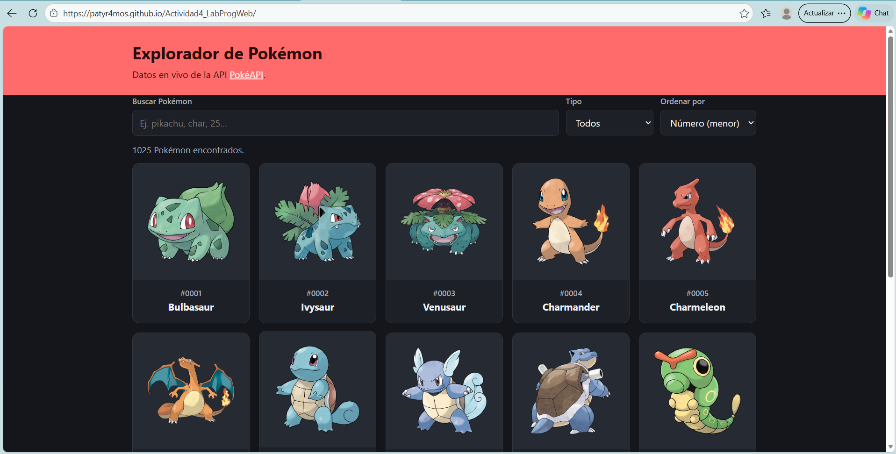

## Descripción

Aplicación de una sola página que consume la API pública [PokéAPI](https://pokeapi.co) mediante `fetch` y `async/await`. Descarga la lista de Pokémon, la procesa en el navegador y construye tarjetas dinámicamente en el DOM. El usuario puede buscar, filtrar por tipo, ordenar, paginar y abrir el detalle de cada Pokémon.

Está hecha con HTML5, CSS3 y JavaScript ES6+, sin librerías ni frameworks.

## API utilizada

PokéAPI v2 (`https://pokeapi.co/api/v2`): pública, gratuita y de solo lectura (únicamente método GET). No requiere llave de acceso ni cuenta y no maneja datos sensibles.

| Uso en la app | Método y endpoint | Datos que se usan |
|---------------|-------------------|-------------------|
| Lista de Pokémon | `GET /pokemon?limit=100000&offset=0` | `name` y `url` (de la url se obtiene el número) |
| Filtro por tipo | `GET /type/{tipo}` | `pokemon`: nombres de los Pokémon de ese tipo |
| Detalle de un Pokémon | `GET /pokemon/{id}` | `id`, `types`, `height`, `weight`, `abilities`, `stats` |

- **Parámetros:** la lista admite `limit` (cuántos recursos devolver) y `offset` (cuántos saltar).
- **Formato de respuesta:** JSON. La lista devuelve `count`, `next`, `previous` y `results` (arreglo de objetos con `name` y `url`).
- **Códigos de respuesta contemplados:** 200 correcto; 404 recurso inexistente; 429 demasiadas solicitudes; 5xx servicio no disponible.
- **Uso responsable:** la lista se guarda en `sessionStorage` y los resultados de cada tipo en memoria, para no repetir peticiones (política de uso justo de PokéAPI).

Estructura simplificada de la respuesta de la lista:

```json
{
  "count": 0,
  "next": null,
  "previous": null,
  "results": [
    { "name": "...", "url": "https://pokeapi.co/api/v2/pokemon/1/" }
  ]
}
```

### Comprobación de la API

Petición vista en la pestaña Network de las herramientas del navegador y respuesta JSON del detalle de un Pokémon:

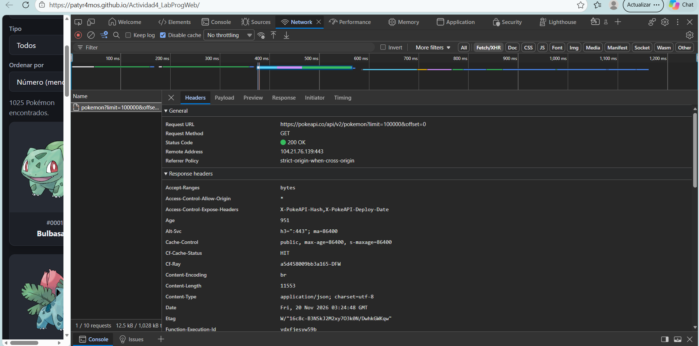

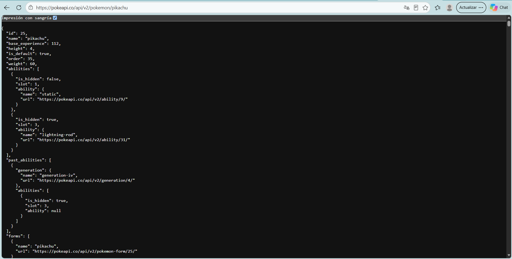

## Funcionalidades

- **Búsqueda** por nombre (por ejemplo `char`) o por número (por ejemplo `25`), sin distinguir acentos ni mayúsculas, con espera de 250 ms para no filtrar en cada tecla.
- **Filtro por tipo**, combinable con la búsqueda.
- **Ordenamiento** por número o por nombre.
- **Paginación** de 12 Pokémon por página.
- **Ventana de detalle** (`dialog`) con tipos, altura, peso, habilidades y estadísticas base.
- **Estados de carga, resultado vacío y error** (sin conexión, tiempo agotado, límite de solicitudes, servicio no disponible o respuesta inválida), con botones «Limpiar filtros» y «Reintentar».
- Diseño adaptable, modo oscuro y navegación con teclado.

## Cómo se consume la API

El consumo está concentrado en la función `fetchJSON` de `app.js`:

- **Tiempo máximo de espera:** `AbortController` con un temporizador de 10 segundos.
- **Estado HTTP:** `fetch` solo rechaza la promesa ante fallas de red, por lo que se revisa `res.ok` y los códigos 404, 429 y 5xx se convierten en errores con mensaje claro.
- **Lectura del JSON:** `res.json()` va en su propio `try/catch` para detectar respuestas que no sean JSON válido.
- **Funciones de consulta:** `getListaPokemon`, `getNombresPorTipo` y `getPokemon` arman cada URL y llaman a `fetchJSON`.

Los datos de la API se insertan con `textContent`, nunca como HTML, para evitar inyección de código.

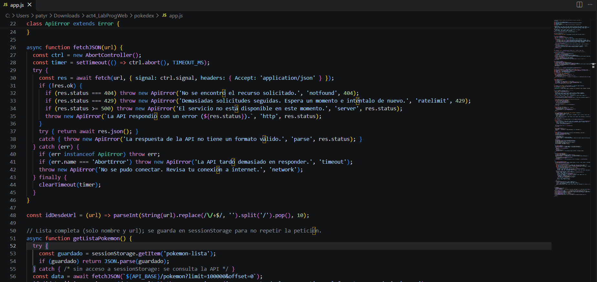

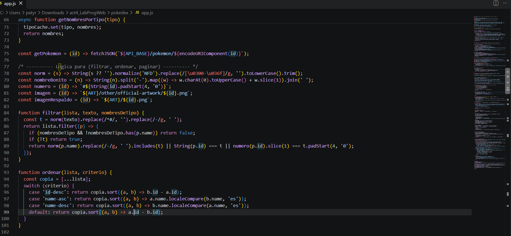

## Capturas de la aplicación

| Búsqueda | Filtro por tipo y orden |
|----------|-------------------------|
| 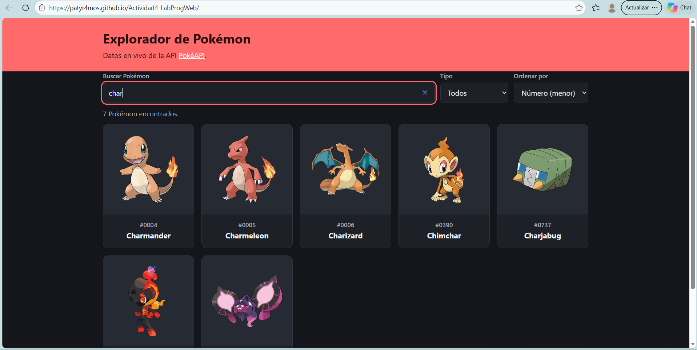 | 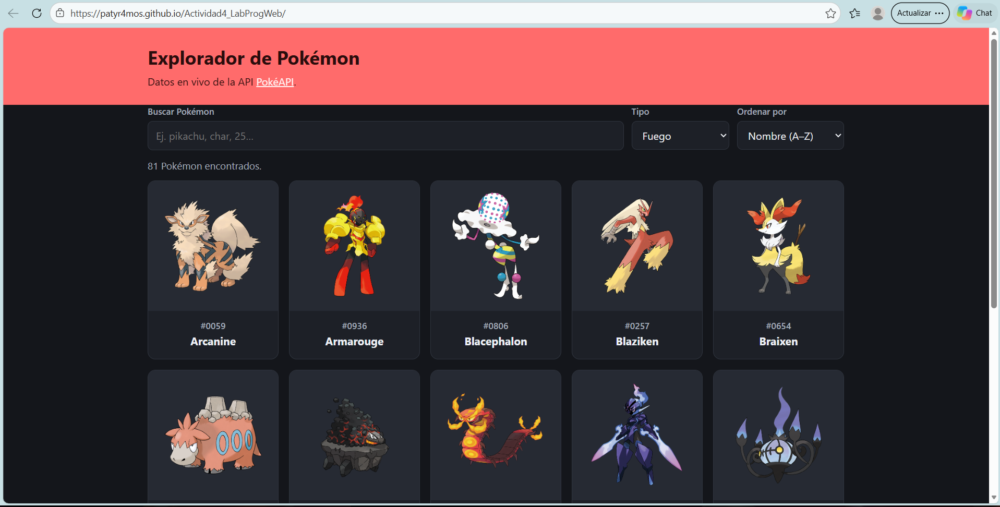 |

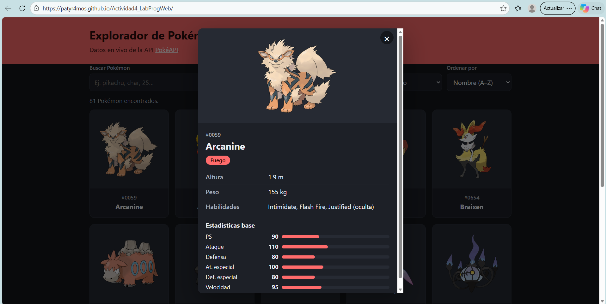

| Carga | Sin resultados | Error |
|-------|----------------|-------|
| 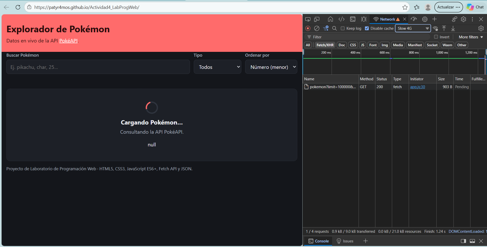 | 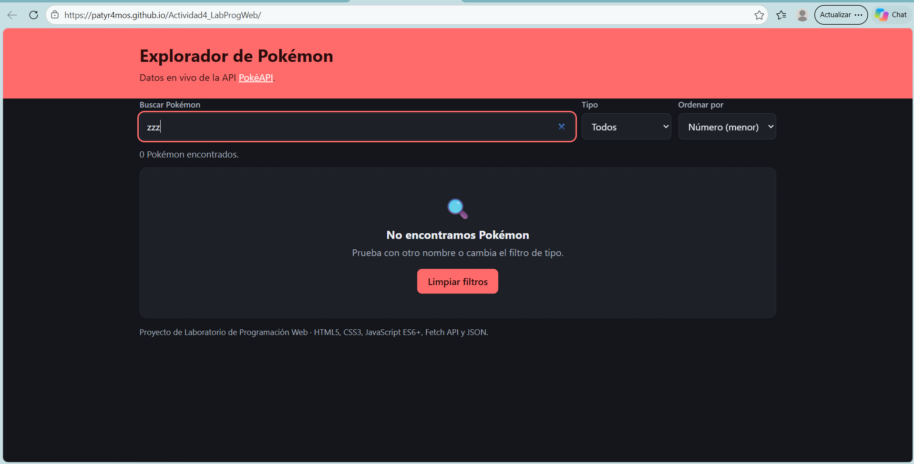 | 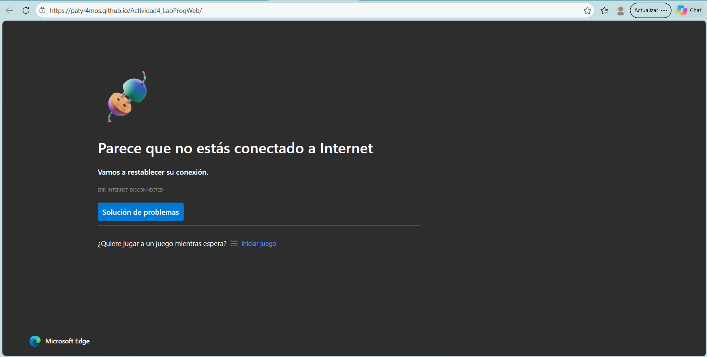 |

## Estructura del proyecto

```
Actividad4_LabProgWeb/
├── index.html    estructura de la página
├── style.css     estilos, diseño adaptable y modo oscuro
├── app.js        consumo de la API, lógica y construcción del DOM
├── README.md     documentación
└── docs/         capturas de pantalla
```

## Cómo usarla

1. Abre https://patyr4mos.github.io/Actividad4_LabProgWeb/ o clona el repositorio:
   ```bash
   git clone https://github.com/patyr4mos/Actividad4_LabProgWeb.git
   ```
2. Abre `index.html` en el navegador (requiere conexión a internet).
3. Escribe en el buscador, elige un tipo, cambia el orden o haz clic en una tarjeta para ver su detalle.

## Control de versiones y despliegue

El proyecto se registró con Git y se publicó en GitHub. El despliegue se hizo con GitHub Pages, que sirve los archivos estáticos desde la rama principal.

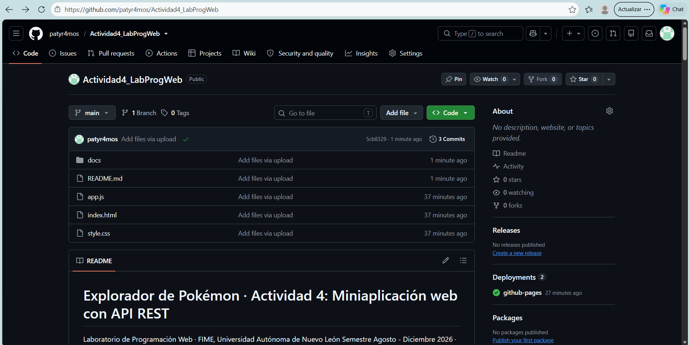

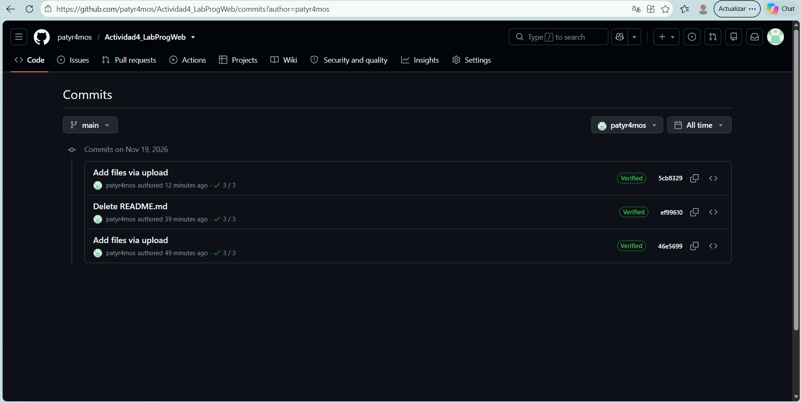

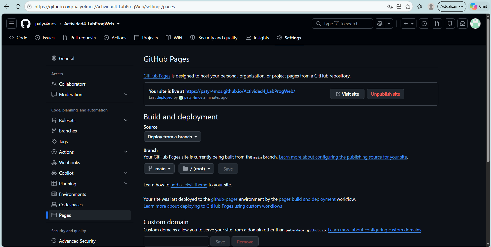

## Reflexión técnica

La primera versión usaba REST Countries v3.1, que dejó de funcionar al publicarla porque la API fue retirada y la versión nueva exige una llave de acceso. Como una llave dentro de una página pública queda expuesta, se cambió a PokéAPI, que no requiere autenticación. Desde entonces se revisa la documentación y la política de uso de una API antes de construir sobre ella.

También quedó claro que `fetch()` solo rechaza la promesa ante errores de red: un 404 o un 500 no lanzan excepción por sí solos, por eso `fetchJSON` revisa `res.ok`. Descargar la lista una sola vez y filtrar, ordenar y paginar en el navegador hace la búsqueda inmediata y respeta la política de uso justo; el filtro por tipo sí consulta la API y guarda el resultado para no repetirlo.
